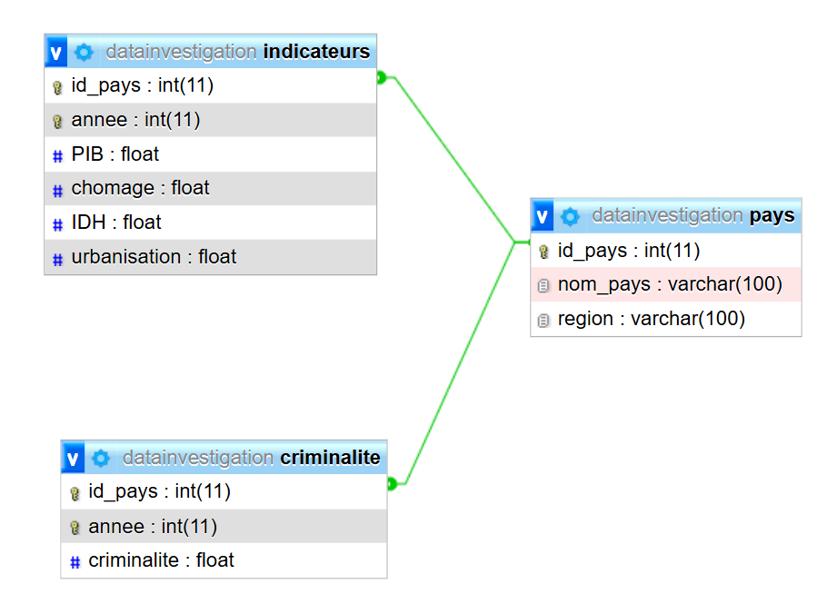

# Introduction {.label:s-intro}

## Dossier d’ouverture

\bigskip

Au cours des dernières années, la criminalité organisée est devenue un enjeu majeur à l’échelle internationale. Les différences observées entre les pays en termes de taux de criminalité soulèvent des interrogations quant aux facteurs pouvant expliquer ces variations. Parmi ces facteurs, les conditions socio-économiques telles que le niveau de revenu, le chômage ou encore les inégalités sociales semblent jouer un rôle déterminant.

\bigskip

Dans le cadre de ce projet, Narjis, Kawthar, Myriam ainsi que Younes ont été missionnés par INTERPOL (a modifier en cas de non droit) afin de mener une enquête sur les causes de la criminalité à l’échelle mondiale. Cette mise en situation permet d’aborder l’analyse de manière concrète, en mobilisant des données réelles pour répondre à une problématique actuelle.

\bigskip

\begin{center}

\textbf{Dans quelle mesure les facteurs socio-économiques influencent-ils le taux de criminalité organisée entre pays a l'échelle l'internationale (2017/2023)?}

\end{center}
\medskip

\justifying

Cette question est particulièrement importante pour les décideurs publics et les organisations internationales, car une meilleure compréhension de ces relations pourrait permettre de mettre en place des politiques de prévention plus efficaces et adaptées aux réalités de chaque pays.

\bigskip

Ce projet s’inscrit dans le cadre des enseignements de bases de données (TE43MI) et de sciences des données (TE44MI). Il repose sur l’analyse de différentes bases de données afin d’identifier les facteurs explicatifs de la criminalité et d’évaluer leur impact.

\newpage

## Responsabilités et composition de l’équipe de recherche

\medskip

| Nom | Statut et id | Missions principales |
|----|----|----|
| ABBASSI Younes | Étudiant n°22401320 | Responsable de la table PAYS (création, harmonisation, contrôles SQL) et co-responsable des analyses descriptives R sur la répartition des pays. |
| ALLAALI Narjis | Étudiante n°22313109 | Responsable de la table INDICATEURS année 2 et des comparaisons temporelles (SQL + préparation des données) et co-responsable des analyses R comparatives. |
| BOUGUIMA Kawthar | Étudiante n°22303487 | Responsable de la table CRIMINALITÉ et de la table finale d’analyse (jointures SQL) et co-responsable des analyses R (corrélations et régressions). |
| TAGHNAKT Myriam | Étudiante n°22403737 | Responsable de la table INDICATEURS année 1 (collecte, nettoyage, intégration SQL) et co-responsable des analyses statistiques R et corrélations. |

# Collecte des preuves — Les données

## Provenance des données

Nous avons utilisé plusieurs sources de données internationales afin d’analyser l’influence des facteurs socio-économiques sur la criminalité.

Les principales sources utilisées sont :

-   Données de criminalité organisée :\
    <https://ocindex.net/downloads>

-   Données socio-économiques (PIB, chômage, urbanisation) :\
    <https://perspective.usherbrooke.ca>

-   Données d’Indice de Développement Humain (IDH) :\
    <https://hdr.undp.org/data-center>

Ces données sont disponibles sous forme de fichiers `CSV/XLSX` ainsi que code `.R`

\bigskip

À partir des jeux de données initiaux, nous avons construit trois tables principales :

-   une table `PAYS`

-   une table `INDICATEURS`

-   une table `CRIMINALITE`

Les données étant réparties dans plusieurs fichiers, nous avons regroupé les indicateurs socio-économiques (PIB, chômage, IDH, urbanisation) dans une seule table.

\bigskip

Afin de réduire le périmètre du projet, nous avons effectué les filtrages suivants :

\
Au niveau des colonnes nous avons conservé uniquement les variables pertinentes :

-   PIB par habitant

-   taux de chômage

-   taux d’urbanisation

-   IDH

-   indice de criminalité

Les autres variables ont été supprimées car non pertinentes pour l’analyse.

\
Pour ce qui est des lignes nous avons conservé

-   les pays avec des données disponibles pour **2017 et 2023** (155 pays)

-   les observations avec aucune valeurs manquantes

\bigskip

La population étudiée correspond à un ensemble de pays pour lesquels les données sont disponibles sur les deux années étudiées.

L’unité statistique est le couple (`pays, année`)

Chaque ligne correspond donc à un pays pour une année donnée.

Ces données permettent d’analyser les liens entre **indicateurs socio-économiques et criminalité**, et ainsi d’apporter des éléments de réponse aux problématiques posées.

## Descriptif des tables

Table 2.1 : Pays (156 x 3)

| nom_colonne | Type | Signification | Caractéristiques |
|----|----|----|----|
| id_pays | CHAR(3) | Code ISO | Clé étrangère |
| annee | INT | Année d'enregistrement des données | Non unique |
| indice_criminalite | FLOAT | Indice de criminalité | Allant de 1 à 10 |

Table 2.2 : Criminalité (311 x 3)

| nom_colonne | Type    | Signification       | Caractéristiques |
|-------------|---------|---------------------|------------------|
| id_pays     | CHAR(3) | Code ISO            | Clé primaire     |
| nom_pays    | VARCHAR | Nom du pays         | Unique           |
| region      | VARCHAR | Région géographique | 19 régions       |

Table 2.3 : Indicateurs (311 x 6)

| nom_colonne  | type    | Signification                       | Caractèristique   |
|--------------|---------|-------------------------------------|-------------------|
| id_pays      | CHAR(3) | Code ISO                            | Clé etrangère     |
| année        | INT     | Année d'observation                 | Non unique        |
| PIB          | FLOAT   | Produit interieur brut par habitant | Valeurs positives |
| chomage      | FLOAT   | Taux de chomage en %                | Entre 0 et 100    |
| IDH          | FLOAT   | Indice de développement humain      | Entre 0 et 1      |
| urbanisation | FLOAT   | \% population urbaine               | Entre 0 et 100    |

\bigskip

Les variables sélectionnées permettent d’analyser l’influence de plusieurs facteurs socio-économiques sur le niveau de criminalité.

Les indicateurs économiques (PIB, chômage), sociaux (IDH) et structurels (urbanisation) sont utilisés comme variables explicatives, tandis que l’indice de criminalité constitue la variable à expliquer.

Cette structuration des données permet d’effectuer des analyses statistiques, afin de répondre à la question de recherche.

# Reconstitution du système — La base de données

-   Le modèle conceptuel de données a été construit afin de représenter les relations entre les pays, les indicateurs socio-économiques et le niveau de criminalité.

    L’entité centrale du modèle est **le pays**, pour lequel plusieurs observations peuvent être enregistrées en fonction des années étudiées (2017 et 2023). 

    ](res/images/mcd.png){#mcd width="400"}

-   Le modèle relationnel de données est obtenu à partir du MCD en traduisant les entités en tables relationnelles.

    Les relations sont implémentées à l’aide des clés étrangères `id_pays` ainsi qu'`annee` , permettant de relier les tables entre elles.

    {#mod width="400"}

\bigskip

## Import des données

Avant l’importation sous Python, un travail de nettoyage et d’harmonisation a été réalisé sous Excel afin de garantir la cohérence entre les différentes sources de données.

\bigskip

-   **Uniformisation des identifiants pays** :\
    Les pays ont été identifiés à l’aide du **code ISO (id_pays)**, utilisé comme clé commune entre les bases.

    *Fonction excel associée* : {`=RECHERCHEX(nom-pays-source!,nom-pays!code-ISO)`}

    Pour chaque pays dont le nom présentait des différences (accents, majuscules, abréviations ou variations d’écriture), une vérification a été mise en place afin de permettre une correction manuelle au cas par cas.

    *Fonction excel associée* : {\*`=SI(code_ISO="";"A corriger";"OK")`}

-   **Filtrage temporel** : Toutes les bases ont été filtrées pour ne conserver que l’année 2023 ainsi que 2017, afin d’assurer la comparabilité des indicateurs.

\medskip

-   **Source de données 1 (.csv) : Criminalité (2023)**

    Suppression des colonnes inutiles, telles que les colonnes non pertinentes pour l’analyse afin de ne conserver que :

    -   la région du pays : (Colonne B : `region`)

    -   le nom du pays : (Colonne C : `country`)

    -   l’indice de criminalité. (Colonne D : `criminality avg.`)

    -   37 variable non utilisées.

\medskip

-   **Source de données 2 (.R) : PIB (2023, 2017)**

    Suppression des colonnes inutiles, telles que les colonnes non pertinentes pour l’analyse afin de ne conserver que :

    -   le code ISO : (Colonne A : `code`)

    -   le pib par habitant : (Colonne C : `NY.GDP.PCAP.PP.CD`)

    -   1 variables non utilisée (nom pays).

\medskip

-   **Source de données 3 (.R) : Chômage (2023, 2017)**

    Suppression des colonnes inutiles, telles que les colonnes non pertinentes pour l’analyse afin de ne conserver que :

    -   le code ISO : (Colonne A : `code`)

    -   le taux de chômage : (Colonne C : `SL.UEM.TOTL.ZS`)

    -   1 variables non utilisée (nom pays).

\medskip

-   **Source de données 4 (.csv) : IDH (2023)**

    Suppression des colonnes inutiles, telles que les colonnes non pertinentes pour l’analyse afin de ne conserver que :

    -   le nom du pays : (Colonne B : `country`)

    -   l'indicede développement humain : (Colonne C : `Human Development Index`)

    -   7 variables non utilisées.

\medskip

-   **Source de données 5 (.R) : Urbanisation (2023, 2017)**

    Suppression des colonnes inutiles, telles que les colonnes non pertinentes pour l’analyse afin de ne conserver que :

    -   le code ISO : (Colonne A : `code`)

    -   le taux d'urbanisation : (Colonne C : `SP.URB.TOTL.IN.ZS`)

    -   1 variables non utilisée (nom pays).

\medskip

Les différentes bases ont ensuite été fusionnées sous Python 3.14.3 ([code présenté en annexe](#sec-annexe-3.1--code-python-de-traitement-des-données)) à l’aide du code ISO comme clé de jointure.

Une jointure interne (inner join) a été utilisée afin de conserver uniquement les pays présents dans l’ensemble des sources de données. Un contrôle des valeurs manquantes a été effectué, et seules les observations avec au maximum une valeur manquante ont été conservées puis ensuite remplacés par une valeur moyenne\footnote{Certaines valeurs manquantes pour les pays suivants ont été complétées manuellement à partir de sources externes (Wikipédia : \url{https://fr.wikipedia.org/wiki/Liste_des_pays_par_IDH}).} La base finale obtenue est ainsi harmonisée et exploitable pour l’analyse.

## Requêtes réalisées

\bigskip

**Combien de pays sont étudiés ?**


``` sql
SELECT COUNT(*)
FROM PAYS;
```


Table: 1 records

| COUNT(*)|
|--------:|
|      155|

Cette requête permet de connaître le nombre total de pays présents dans l’étude. Elle sert à présenter la taille du jeu de données.

\medskip
\medskip

**Quel est le niveau moyen de criminalité organisée dans la base ?**


``` sql
SELECT AVG(criminalite)
FROM CRIMINALITE;
```


Table: 1 records

| AVG(criminalite)|
|----------------:|
|            5.255|

Cette requête donne la moyenne générale de l’indice de criminalité organisée. Elle permet d’avoir une première vision globale du phénomène.

\newpage

**Quels sont les 10 pays ayant les niveaux de criminalité organisée les plus élevés ?**


``` sql
SELECT p.nom_pays, c.annee, c.criminalite
FROM CRIMINALITE c, PAYS p
WHERE c.id_pays = p.id_pays
ORDER BY c.criminalite DESC
LIMIT 10;
```


Table: Displaying records 1 - 10

|nom_pays | annee| criminalite|
|:--------|-----:|-----------:|
|Myanmar  |  2023|        8.15|
|RD Congo |  2017|        7.75|
|Colombie |  2023|        7.75|
|Colombie |  2017|        7.66|
|Myanmar  |  2017|        7.59|
|Mexique  |  2023|        7.57|
|Mexique  |  2017|        7.56|
|Paraguay |  2023|        7.52|
|RD Congo |  2023|        7.35|
|Nigeria  |  2023|        7.28|

Cette requête identifie le Top 10 des pays les plus criminels entre l’année 2017 et 2023. Elle permet d'avoir une vue d'ensemble rapide des pays où la criminalité est la plus élevée

\medskip

**Quel est la moyenne de criminalité organisée par région du monde ?**


``` sql
SELECT p.region, AVG(c.criminalite) AS moyenne_criminalite
FROM CRIMINALITE c, PAYS p
WHERE c.id_pays = p.id_pays
GROUP BY p.region
ORDER BY moyenne_criminalite DESC;
```


Table: Displaying records 1 - 10

|region                        | moyenne_criminalite|
|:-----------------------------|-------------------:|
|Asie du Sud-Est               |            6.127222|
|Asie de l'Ouest               |            5.971667|
|Afrique de l'Est              |            5.919286|
|Caraïbes et Amérique centrale |            5.734091|
|Amérique du Nord              |            5.640000|
|Amérique du Sud               |            5.637727|
|Asie du Sud                   |            5.553572|
|Afrique de l'Ouest            |            5.457333|
|Afrique centrale              |            5.420500|
|Europe du Sud                 |            5.140833|

Cette requête calcule la moyenne des indices de criminalité organisée pour chaque région.

Elle permet d’identifier les régions du monde où la criminalité organisée est globalement la plus importante.

**Quelles sont les régions ayant plus de 3 pays avec une criminalité élevée ?**

\medskip
\medskip


``` sql
SELECT p.region, AVG(c.criminalite) AS moyenne_criminalite
FROM CRIMINALITE c, PAYS p
WHERE c.id_pays = p.id_pays
GROUP BY p.region
ORDER BY moyenne_criminalite DESC;
```


Table: Displaying records 1 - 10

|region                        | moyenne_criminalite|
|:-----------------------------|-------------------:|
|Asie du Sud-Est               |            6.127222|
|Asie de l'Ouest               |            5.971667|
|Afrique de l'Est              |            5.919286|
|Caraïbes et Amérique centrale |            5.734091|
|Amérique du Nord              |            5.640000|
|Amérique du Sud               |            5.637727|
|Asie du Sud                   |            5.553572|
|Afrique de l'Ouest            |            5.457333|
|Afrique centrale              |            5.420500|
|Europe du Sud                 |            5.140833|

Cette requête utilise une sous-requête pour sélectionner les pays à forte criminalité avec un indice supérieur a 6, puis regroupe ces pays par région.

**Quelles régions comptent plus de 2 pays avec un IDH faible ?**

\medskip
\medskip


``` sql
SELECT region
FROM PAYS
WHERE id_pays IN (
    SELECT i.id_pays
    FROM INDICATEURS i
    WHERE i.IDH < 0.5
)
GROUP BY region
HAVING COUNT(*) > 2;
```


Table: 4 records

|region             |
|:------------------|
|Afrique australe   |
|Afrique centrale   |
|Afrique de l'Est   |
|Afrique de l'Ouest |

Cette requête met en évidence les régions concentrant plusieurs pays peu développés avec un IDH \< 0.5.

**Quels sont les pays dont le PIB est faible et dont la criminalité est élevée ?**


``` sql
SELECT p.nom_pays,c.criminalite,i.PIB
FROM CRIMINALITE c,INDICATEURS i,PAYS p
WHERE c.id_pays = i.id_pays
AND c.annee = i.annee
AND c.id_pays = p.id_pays
AND i.PIB < 5000
AND c.criminalite>5
```


Table: Displaying records 1 - 10

|nom_pays                  | criminalite|      PIB|
|:-------------------------|-----------:|--------:|
|Afghanistan               |        7.08| 2335.800|
|Afghanistan               |        7.10| 2201.720|
|Bénin                     |        5.25| 2885.890|
|Bénin                     |        5.32| 4129.970|
|Burkina Faso              |        5.49| 2042.400|
|Burkina Faso              |        5.92| 2759.300|
|République centrafricaine |        7.04|  883.811|
|République centrafricaine |        6.75| 1257.090|
|Côte d'Ivoire             |        6.15| 4690.180|
|Cameroun                  |        6.31| 3767.430|

Cette requête permet d’identifier les pays qui cumulent faibles ressources économiques et criminalité élevée. Elle met en évidence des situations de vulnérabilité.

**Quels pays apparaissent plusieurs fois avec forte criminalité et chômage élevé ?**


``` sql
SELECT p.nom_pays, COUNT(*) AS nb_cas 
FROM CRIMINALITE c, INDICATEURS i, PAYS p 
WHERE c.id_pays = i.id_pays AND c.annee = i.annee 
AND c.id_pays = p.id_pays AND c.criminalite >= 6 
AND i.taux_chomage > 10 GROUP BY p.nom_pays HAVING COUNT(*) >= 2;
```


Table: 8 records

|nom_pays       | nb_cas|
|:--------------|------:|
|Afghanistan    |      2|
|Afrique du Sud |      2|
|Irak           |      2|
|Liban          |      2|
|Libye          |      2|
|Népal          |      2|
|Soudan         |      2|
|Syrie          |      2|

Cette requête identifie les pays qui cumulent plusieurs années de forte criminalité et de chômage élevé, ce qui met en évidence des situations critiques durables.###A MODIFIER ON NE MET PAS EN EVIDENCE ON EMET UNE HYPOTHESE

**Quels sont les pays dont la criminalité organisée est supérieure à la moyenne de leur région ?**


``` sql
SELECT p.nom_pays, p.region, c.criminalite 
FROM criminalite c, pays p 
WHERE c.id_pays = p.id_pays 
AND c.criminalite > ( SELECT AVG(c2.criminalite) 
FROM CRIMINALITE c2, PAYS p2 WHERE c2.id_pays = p2.id_pays 
AND p2.region = p.region );
```


Table: Displaying records 1 - 10

|nom_pays            |region                        | criminalite|
|:-------------------|:-----------------------------|-----------:|
|Afghanistan         |Asie du Sud                   |        7.08|
|Afghanistan         |Asie du Sud                   |        7.10|
|Angola              |Afrique centrale              |        5.58|
|Albanie             |Europe centrale et orientale  |        5.63|
|Albanie             |Europe centrale et orientale  |        5.17|
|Émirats arabes unis |Asie de l'Ouest               |        6.37|
|Australie           |Australie et Nouvelle-Zélande |        4.00|
|Australie           |Australie et Nouvelle-Zélande |        4.00|
|Azerbaïdjan         |Asie centrale et Caucase      |        5.08|
|Azerbaïdjan         |Asie centrale et Caucase      |        4.80|

Cette requête compare chaque pays à la moyenne de sa région. Elle permet d’identifier les pays dont la criminalité est anormalement élevée dans leur contexte régional.

## Quelques détails techniques

Dans ce projet, nous avons utilisé RMarkdown pour interagir directement avec la base de données.

Un chunk de connexion SQL fourni dans le fichier connexionBDD.Rmd a été utilisé afin d’établir la connexion à la base. Cela nous a permis d’exécuter les requêtes SQL directement depuis R et d’afficher les résultats dans le rapport.

Avant cela, les requêtes ont été testées dans phpMyAdmin afin de vérifier leur bon fonctionnement et la cohérence des résultats.

Une fois validées, les requêtes ont été intégrées dans le document RMarkdown.

Cette méthode nous a également permis de nous entraîner à manipuler les données directement dans R, en vue de réaliser ensuite les analyses et les visualisations.

# Matériel et Méthodes

## Logiciels

Lister tous les logiciels utilisés pour la partie statistique du rapport (et également ceux pour gérer et communiquer entre les membres du projet s'il y en a en particulier)

\medskip

R (ou Python) est le logiciel à privilégier pour la Science des Données. Pour assurer une reproductibilité maximale, vous devriez utiliser R Markdown (ou un Notebook Jupyter, et éventuellement un outil de gestion des versions tel que `Git`), par exemple via Google Colab ou RStudio dans les nuages. Évitez d'utiliser Word!

\bigskip

Il est de votre responsabilité de donner les versions des logiciels que vous utilisez, ainsi que de donner des informations techniques sur l'ordinateur qui vous a servi pour les analyses (système d'exploitation, vitesse du processeur, etc.). Penser à fournir des citations pour les logiciels utilisés, par exemple \footnote{L'entrée BibTeX ajoutée dans le fichier \texttt{references.bib} a été obtenue grâce à la commande  \texttt{citation(package = "tidyverse")} tapée dans la console de R.}.

## Modélisation statistique

Quels outils ou méthodes de statistiques allez-vous utiliser? Donner des équations mathématiques s'il y a lieu et lister les éventuels présupposés («assumptions» en anglais) que vous devez faire sur les données afin d'utiliser ces outils ou méthodes (*e.g.*, normalité, absence de valeurs aberrantes, etc.).

Il est également bon d'indiquer quelles sont les avantages et les limites de ces méthodes.

Vous pourrez consulter avec profit les Chapitre 11--13 du livre sur R :

<http://biostatisticien.eu/springeR/livreR.pdf>

# Premiers indices — Analyse exploratoire

Toute étude impliquant des données doit **obligatoirement** inclure une analyse exploratoire préalable. Celle-ci permet de mieux comprendre l'information contenue dans les données.

Il faut produire de nombreux résumés graphiques (*e.g.*, histogrammes, nuages de points, boxplots, etc.) et numériques (*e.g.*, médiane, moyenne, variance, etc.). Ainsi, il faut faire une analyse descriptive uni- et bivariée systématique de toutes les variables du jeu de données. Puis, il faut uniquement conserver les plus pertinents (les autres pouvant être gardés en Annexe), c'est-à-dire ceux qui permettront de dégager des éléments de réponse pour la question de recherche envisagée. Chaque figure et tableau doit être commenté. Mais il ne faut pas extrapoler et dire des choses qui ne sont pas visibles dans ces graphiques ou tableaux. Pour chaque analyse, vous pourrez préciser le nombre d'individus/ d'unités statistiques concernés au total.

Vous pourrez consulter avec profit le Chapitre 9 du livre sur R :

<http://biostatisticien.eu/springeR/livreR.pdf>

## Utiliser R {.fragile}

Il est facile d'inclure des codes R dans votre rapport, qui seront exécutés à la volée (*i.e.*, lors de la traduction de votre fichier `Rmd` en fichier `PDF` ou `DOC`). Par exemple:


``` r
boxplot(cars, col = c("#5975a4", "#cc8963"))
```

\begin{figure}

{\centering \includegraphics[width=7cm]{scdon2-UPV-report-template_files/figure-latex/unnamed-chunk-10-1} 

}

\caption{\label{fig:boxplots}Deux boxplots.}\label{fig:unnamed-chunk-10}
\end{figure}

``` r
colMeans(cars)
```

```
## speed  dist 
## 15.40 42.98
```

Les lignes de code ne doivent pas dépasser dans la marge de droite. Ainsi on pourrait remplacer le chunk ci-dessous:


``` r
boxplot(cars, main = "Un titre qui est vraiment beaucoup trop long et qui dépasse dans la marge de droite")
```

\begin{figure}

{\centering \includegraphics[width=7cm]{scdon2-UPV-report-template_files/figure-latex/unnamed-chunk-11-1} 

}

\caption{Pas super.}\label{fig:unnamed-chunk-11}
\end{figure}

par celui-ci:

\tiny


``` r
boxplot(cars, 
        main = "Un titre qui est vraiment beaucoup trop long\n mais qui ne dépasse plus dans la marge de droite")
```

\begin{figure}

{\centering \includegraphics[width=7cm]{scdon2-UPV-report-template_files/figure-latex/unnamed-chunk-12-1} 

}

\caption{Déjà mieux.}\label{fig:unnamed-chunk-12}
\end{figure}

\normalsize

où l'on a:

-   utilisé la commande \LaTeX `\tiny` pour changer la taille de la police (suivi de de `\normalsize` pour revenir à la taille normale),
-   mis l'instruction `main = ...` sur la deuxième ligne,
-   utilisé `\n` pour afficher le titre sur deux lignes.

\vspace{3em}

**Remarques** : Contrairement aux graphiques précédents, nous vous demandons, pour effectuer les graphiques, d'utiliser le package `ggplot2`. Voir <https://juba.github.io/tidyverse/08-ggplot2.html> pour une courte introduction.

# Mise à l’épreuve — Modélisation

Dans cette partie, vous pourrez utiliser les outils et méthodes vus au semestre précédent pour analyser les liens entre les variables.

Pour cela, vous pourrez utiliser les tests du $\chi^2$, test du coefficient de corrélation linéaire, test d'Anova, la droite de régression linéaire.

Vous pourrez également proposer des modèles pour faire du clustering (k-means, CAH), de la classification (K plus proches voisins par exemple) comme vu en Science des données 1.

## La droite de régression linéaire : un premier exemple

Si on souhaite expliquer les variations d'une variables réponse $Y$ en fonction d'un certain nombre de prédicteurs $x_1,\ldots,x_p$, on peut utiliser un modèle de régression linéaire simple ($p=1$) ou multiple ($p>1$)

$$
Y_i = \beta_0 + \beta_1 x_{1i} + \cdots +\beta_p x_{pi} + \epsilon_i, \qquad i=1,\ldots,n.
$$ où l'on présuppose que les $\epsilon_i$ sont i.i.d. $N(0,1)$ pour tout $i=1,\ldots,n$ ($n$ étant la taille de l'échantillon).

Vous pourrez toujours consulter avec profit les Chapitre 11--13 du livre sur R :

<http://biostatisticien.eu/springeR/livreR.pdf>

Ces chapitres détaillent l'utilisation de certains tests et modèles sous `R`.

# Interprétation — Résolution de l’enquête

Placer les résultats que vous avez obtenus dans le chapitre précédent en perspective par rapport au problème étudié.

# Conclusion — Verdict {.label:ccl}

Quelles sont les conclusions principales? Quelles sont vos recommandations pour le commanditaire? Quelles analyses subséquentes pourraient être faites dans le futur?

\bigskip

On attend de vous deux types de perspectives : des perspectives à court terme pour améliorer rapidement votre approche et des perspectives à plus long terme qu'elles soient liées à la science des données ou au domaine métier pour lequel vous avez travaillé.

\bigskip

Lister également les difficultés rencontrées dans la partie BD (e.g., taille de la base, manque de données, ...) et dans la partie statistique.

# Bibliographie {.unnumbered}

::: {#refs}
:::

\bibliographystyle{elsarticle-harv}
\bibliography{references}

# Annexes {.unnumbered}

Il faut utiliser les annexes de façon judicieuse. C'est ici que l'on place des résultats trop volumineux pour apparaître dans le corps du rapport. Ou bien des résultats (e.g., graphiques) moins intéressants que les autres. Cela permet de limiter le nombre de pages du coeur du rapport, et d'ajouter des détails dans cette partie pour le lecteur désireux d'en savoir plus.

## **Codes** {.unnumbered}

#### **Annexe 3.1** : Code Python de traitement des données {#sec-annexe-3.1--code-python-de-traitement-des-données}

Le code ci-dessous permet d’importer les différentes bases de données, de les fusionner à l’aide du code ISO, puis de filtrer les observations en fonction des valeurs manquantes.


``` python
"""
Auteur : Groupe DataInvestigation
Création : 01/04/2026
Contenu : Code de tri et fusion ayant pour résultat une table excel
"""
import pandas as pd
from functools import reduce


crime = pd.read_excel("criminalite.xlsx")
chomage = pd.read_csv("chomage.csv")
idh = pd.read_excel("idh.xlsx")
urbanisation = pd.read_csv("urbanisation.csv")
pib = pd.read_csv("pib.csv")

#Suppression des doublons code ISO

crime = crime.drop_duplicates(subset="code_ISO")
chomage = chomage.drop_duplicates(subset="code_ISO")
idh = idh.drop_duplicates(subset="code_ISO")
urbanisation = urbanisation.drop_duplicates(subset="code_ISO")

#Fusion permettant de garder les pays présents partout

liste_tables = [crime, chomage, idh, urbanisation]

table_finale = reduce(
    lambda gauche, droite: pd.merge(gauche, droite, on="code_ISO", how="inner"),
    liste_tables
)

#Comptage de valeurs manquantes 

colonnes_indicateurs = [
    "indice_criminalite",
    "taux_chomage",
    "IDH",
    "taux_urbanisation"
]

table_finale["nb_valeurs_manquantes"] = table_finale[colonnes_indicateurs].isna().sum(axis=1)

#Garder les pays avec 0 ou 1 valeurs manquantes max

table_finale = table_finale[table_finale["nb_valeurs_manquantes"] <= 1]

#Tri par pays

table_finale = table_finale.sort_values("nom_pays")

#Export

table_finale.to_excel("BD_INDICATEURS.xlsx", index=False)
```

## **Tables** {.unnumbered}

Si vous avez des tableaux supplémentaires, vous pouvez les ajouter ici.

Utiliser <https://www.tablesgenerator.com/markdown_tables> pour créer des tables Markdown simples, ou bien utiliser \LaTeX.

1.  Table Markdown

| Les tables |       sont       |   cool |
|------------|:----------------:|-------:|
| col 1 est  | alignée à gauche | \$1600 |
| col 2 est  |     centrée      |   \$12 |
| col 3 est  | alignée à droite |    \$1 |

: une légende au-dessus du tableau. \label{tab7.1}

Aligner les nombres de la troisième colonne sur la droite permet d'afficher les unités au-dessus des unités, les dizaines au-dessus des dizaines, etc. Il faut toujours privilégier cette présentation.

\vspace{3em}

2.  Table Latex

\begin{table}[h]
\centering
\caption{une légende au-dessus du tableau}
\label{tab7.1}
\begin{tabular}{lcr}
\hline
Les tables & sont & cool \\
\hline
col 1 est & alignée à gauche & 1600 \\
col 2 est & centrée & 12 \\
col 3 est & alignée à droite & 1 \\
\hline
\end{tabular}
\end{table}

\textbf{Remarques}

\begin{itemize}
  \item \{lcr\} : gauche (l), centré (c), droite (r)
  \item \verb|\caption| place la légende au-dessus
  \item \verb|\label| permet de référencer le tableau (\verb|\ref{tab7.1}|)
  \item Les nombres sont bien alignés à droite dans la 3\ieme{} colonne
\end{itemize}
